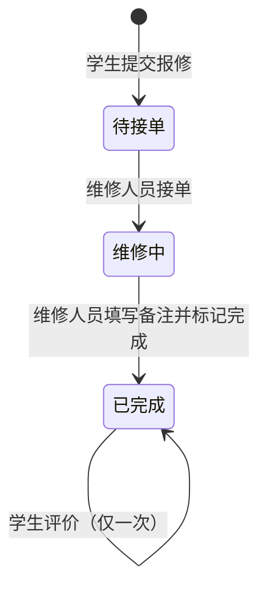

# 学生宿舍报修管理系统

学生宿舍线上报修系统，替代纸质登记，实现 **学生提交报修 → 维修人员接单处理 → 学生查看进度并评价** 的完整闭环。

- 角色：**学生**（自主注册）、**维修人员**（数据库预置账号，不开放注册）
- 技术栈：Spring Boot 3.5 + Thymeleaf + MyBatis + MySQL 8（单体项目，一条命令启动）

---

## 一、运行环境

| 软件 | 版本 |
|---|---|
| JDK | 17 及以上 |
| Maven | 不需要单独安装（项目自带 Maven Wrapper：`mvnw` / `mvnw.cmd`） |
| MySQL | 8.x |

> **Windows 用户**：详细的安装、部署、演示和排错步骤见 [docs/windows-deploy.md](docs/windows-deploy.md)。
> 也可以直接双击 `deploy\windows\build.bat` 打包，再双击 `dist\dorm-repair\start.bat` 启动（脚本会自动检查 Java、端口和 MySQL）。

## 二、快速开始

1. **安装并启动 MySQL 8**，记住 root 密码。
2. **修改数据库密码**：打开 `src/main/resources/application.yml`，把 `password: ${DB_PASSWORD:root}` 中的 `root` 改成你的 MySQL 密码（用户名不是 root 的同理修改 `username`）。
   - 不需要手动建库建表：JDBC 连接串带了 `createDatabaseIfNotExist=true`，启动时会自动创建 `dorm_repair` 数据库，并执行 `db/schema.sql`（建表）和 `db/data.sql`（预置账号）。
   - 脚本使用 `CREATE TABLE IF NOT EXISTS` 和 `INSERT IGNORE`，**重复启动不会清空或覆盖已有数据**。
3. **启动项目**（二选一）：
   - IDEA：打开项目，运行 `com.dorm.repair.DormRepairApplication` 的 `main` 方法；
   - 命令行（Windows 用 `mvnw.cmd`，Linux / macOS 用 `./mvnw`）：
     ```bash
     ./mvnw spring-boot:run
     ```
4. 浏览器访问 <http://localhost:8080>。

## 三、默认账号

| 角色 | 账号 | 密码 | 说明 |
|---|---|---|---|
| 维修人员 | W001 | 123456 | 张师傅 |
| 维修人员 | W002 | 123456 | 李师傅 |
| 维修人员 | W003 | 123456 | 王师傅 |
| 学生 | 2023001 | 123456 | 演示账号，可在 `data.sql` 中删除 |

学生也可以在登录页点击"学生注册"自行注册（学号即登录账号）。

**新增维修人员**：在 `src/main/resources/db/data.sql` 中复制一行维修人员记录，改工号、姓名、手机号，密码字段保持不变（即初始密码 123456），重启后生效；维修人员登录后可自行修改密码。

## 四、功能清单

| 模块 | 功能 |
|---|---|
| 登录注册 | 学生注册（学号、姓名、楼栋、宿舍号、手机号、密码）；账号密码登录；修改个人信息；修改密码（需验证原密码，修改后重新登录）；退出登录 |
| 学生端 | 首页公告（写死在 `templates/student/home.html`）+ 工单统计；提交报修（楼栋宿舍默认带出本人信息，类型：水电/门窗/家具/卫生间，故障描述，可选图片）；我的报修（按 待接单/维修中/已完成 筛选）；工单详情（进度条、维修人员及备注）；完成后星级 + 文字评价（每单一次） |
| 维修人员端 | 待接单列表（先报先修）；接单（→ 维修中）；填写维修备注并标记完成（→ 已完成）；我的维修记录（含学生评价） |

## 五、业务流程与工单状态



状态只能单向流转，不能跳过、不能回退。

## 六、项目结构

```
src/main/java/com/dorm/repair
├── DormRepairApplication.java    启动类
├── config/                       PasswordConfig（BCrypt）、WebConfig（注册拦截器、图片访问路径）
├── interceptor/AuthInterceptor   登录校验 + 角色权限隔离
├── controller/                   AuthController 登录注册 / ProfileController 个人中心
│                                 StudentController 学生端 / RepairerController 维修人员端
├── service/                      UserService / RepairOrderService / FileStorageService（图片存储）
├── mapper/                       MyBatis 注解 SQL：UserMapper / RepairOrderMapper
├── entity/                       User / RepairOrder（对应数据库表）
├── dto/                          表单对象（带校验注解）、LoginUser（session 中的登录信息）
├── enums/                        Role / OrderStatus / RepairCategory（写死的枚举）
└── common/                       常量、业务异常、全局异常处理
src/main/resources
├── application.yml               配置
├── db/schema.sql, db/data.sql    建表脚本、预置账号
├── templates/                    Thymeleaf 页面（fragments/ 为公共片段）
└── static/css/style.css          样式（不依赖 CDN，断网可用）
deploy/windows/                   Windows 打包与部署脚本（build.bat 生成 dist\dorm-repair\，内含 start.bat / stop.bat）
docs/windows-deploy.md            Windows 部署与操作指南
```

分层调用关系：`页面 → Controller → Service → Mapper → MySQL`。

## 七、数据库设计

**sys_user 用户表**（学生和维修人员共用，`role` 区分）

| 字段 | 类型 | 说明 |
|---|---|---|
| id | BIGINT PK | 自增主键 |
| username | VARCHAR(32) UNIQUE | 学号 / 工号 |
| password | VARCHAR(100) | BCrypt 密文 |
| real_name | VARCHAR(32) | 姓名 |
| role | VARCHAR(16) | STUDENT / REPAIRER |
| phone | VARCHAR(11) | 手机号 |
| building, room_no | VARCHAR | 楼栋、宿舍号（仅学生） |
| created_at, updated_at | DATETIME | 创建 / 修改时间 |

**repair_order 工单表**（评价与工单一对一，直接存在本表）

| 字段 | 类型 | 说明 |
|---|---|---|
| id | BIGINT PK | 工单号 |
| student_id | BIGINT FK | 报修学生 |
| building, room_no | VARCHAR | 报修位置 |
| category | VARCHAR(20) | WATER_ELECTRIC / DOOR_WINDOW / FURNITURE / BATHROOM |
| description | VARCHAR(500) | 故障描述 |
| image_path | VARCHAR(255) | 图片相对路径（可空） |
| status | VARCHAR(20) | PENDING / IN_PROGRESS / COMPLETED |
| repairer_id | BIGINT FK | 接单维修人员（可空） |
| repair_note | VARCHAR(500) | 维修备注 |
| rating, evaluation | TINYINT, VARCHAR(200) | 评价星级、评价内容 |
| created_at, accepted_at, completed_at, rated_at | DATETIME | 各环节时间，用于进度条 |

索引：`status`（待接单池）、`student_id`（我的报修）、`repairer_id`（我的维修）。

## 八、关键实现说明（答辩要点）

1. **角色权限隔离在服务端完成**（`AuthInterceptor`）
   未登录访问任何页面都跳转登录页；`/student/**` 只允许学生，`/repair/**` 只允许维修人员，否则返回 403。即使手动输入 URL 或伪造 POST 请求也无法越权，不是仅仅"隐藏菜单"。
2. **数据归属校验**（`RepairOrderService`）
   学生只能查看 / 评价自己的工单；维修人员只能查看待接单工单和自己接过的工单，只能完成自己接的单。改地址栏中的工单 id 也看不到别人的数据。
3. **防止重复接单**（`RepairOrderMapper.accept`）
   ```sql
   UPDATE repair_order SET status='IN_PROGRESS', repairer_id=? WHERE id=? AND status='PENDING'
   ```
   数据库对单行 UPDATE 加行锁、原子执行，多人同时接同一单时只有一条语句能匹配 `status='PENDING'`，返回影响行数 1，其余返回 0 并提示"已被其他维修人员接单"。完成、评价同理带状态条件，保证状态只能单向流转、每单只评价一次。
4. **密码安全**：BCrypt 加盐单向加密存储；登录失败统一提示"账号或密码错误"，不暴露账号是否存在；登录成功后更换 session id 防会话固定；改密需验证原密码。
5. **注册不能伪造角色**：注册表单没有角色字段，服务端固定写入 STUDENT。
6. **图片上传校验**：限制扩展名（jpg/png/gif/webp）、大小（≤5MB），并检查文件头魔数，防止把其他文件改扩展名上传；文件名用 UUID，未登录不能访问图片。
7. **其他**：表单使用 Bean Validation 注解校验；提交后重定向（PRG 模式）防止刷新重复提交；退出登录用 POST；会话 cookie 设置 HttpOnly + SameSite=Lax。

## 九、测试

```bash
./mvnw test
```

测试使用 H2 内存数据库（MySQL 兼容模式），**不需要安装 MySQL**。`DormRepairApplicationTests` 覆盖：

- 完整闭环：注册 → 登录 → 提交报修（含图片）→ 接单 → 完成 → 评价
- 角色隔离：学生访问维修人员接口、维修人员提交报修均返回 403；未登录跳转登录页
- 越权：学生 B 查看 / 评价学生 A 的工单被拒绝
- 重复接单被拒、未完成不能评价、不能重复评价、维修备注必填
- 12 个线程并发接同一单，只有 1 个成功
- 注册校验（学号重复、手机号格式、两次密码不一致、伪造楼栋、伪造角色）
- 上传非图片文件被拒绝；修改密码与个人信息

## 十、常见问题

- **启动报 `Access denied for user 'root'`**：`application.yml` 中数据库用户名 / 密码不对。也可以不改文件，用环境变量 `DB_USERNAME`、`DB_PASSWORD`、`DB_HOST`、`DB_PORT` 覆盖。
- **8080 端口被占用**：修改 `application.yml` 中 `server.port`。
- **在 MySQL 命令行手动执行 SQL 脚本出现中文乱码**：用 `mysql --default-character-set=utf8mb4` 登录后再执行。正常启动项目时自动执行，不会有此问题。
- **上传的图片在哪里**：项目启动目录下的 `uploads/`（可在 `app.upload-dir` 修改），已加入 `.gitignore`。

## 十一、可扩展方向

- 学生撤销待接单的工单、维修人员退单（转回待接单）
- 管理员角色：维修人员账号管理、公告后台维护、数据统计报表
- 工单列表分页、按楼栋 / 类型搜索
- 接单、完成时短信或站内消息通知学生
