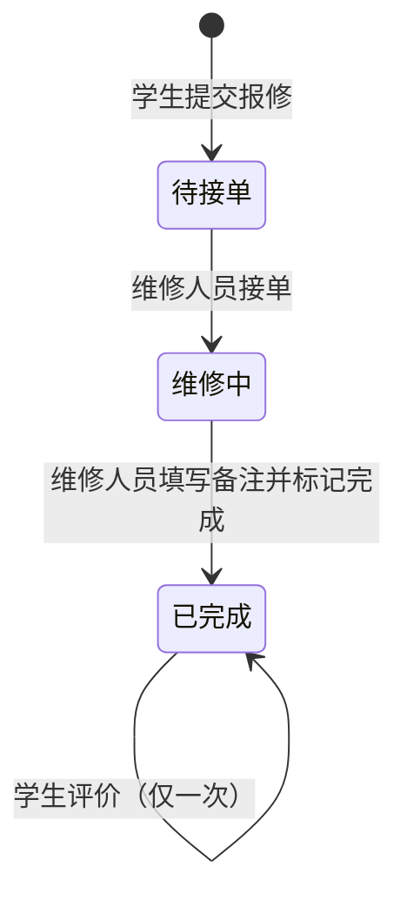

# 学生宿舍报修管理系统（Python 版）

学生宿舍线上报修系统，替代纸质登记，实现 **学生提交报修 → 维修人员接单处理 → 学生查看进度并评价** 的完整闭环。

- 角色：**学生**（自主注册）、**维修人员**（系统预置账号，不开放注册）
- 技术栈：Python 3.10+ / Flask 3.1 + Jinja2 模板 / Flask-SQLAlchemy（ORM）/ Flask-WTF（表单校验 + CSRF 防护）/ MySQL 8 / waitress
- 需求与 Java 版完全相同；**Java 版（Spring Boot）在分支 `claude/youthful-cerf-yhmk2y`**。

> **Windows 用户**：详细的安装、部署、演示和排错步骤见 [docs/windows-deploy.md](docs/windows-deploy.md)。
> 装好 Python 和 MySQL 后，双击 `setup.bat` 安装依赖，修改 `config.ini` 中的数据库密码，再双击 `start.bat` 即可。

---

## 一、运行环境

| 软件 | 版本 |
|---|---|
| Python | 3.10 ~ 3.13（推荐 3.12） |
| MySQL | 8.x |

## 二、快速开始

**Windows（脚本）**：双击 `setup.bat` → 修改 `config.ini` 中的密码 → 双击 `start.bat`，浏览器自动打开 <http://localhost:5000>。

**命令行（Windows / Linux / macOS 通用）**：

```bash
python -m venv .venv
```

```bash
.venv\Scripts\activate
```
（Linux / macOS 为 `source .venv/bin/activate`）

```bash
pip install -r requirements-dev.txt -i https://mirrors.aliyun.com/pypi/simple/
```

```bash
python run.py --dev
```

首次运行会把 `config.example.ini` 复制为 `config.ini`，请把其中的数据库密码改成你的 MySQL 密码后重新运行。不需要手动建库建表：启动时自动创建 `dorm_repair_py` 数据库（utf8mb4）、数据表和预置账号，重复启动不会清空已有数据。

| 命令 | 说明 |
|---|---|
| `python run.py` | 正式运行（waitress 服务器，监听 0.0.0.0:5000，局域网可访问） |
| `python run.py --dev` | 开发调试（修改代码自动重启、控制台打印 SQL，只监听本机） |
| `python run.py --init-db` | 只初始化数据库后退出，用于检查数据库配置 |

## 三、默认账号

| 角色 | 账号 | 密码 | 说明 |
|---|---|---|---|
| 维修人员 | W001 | 123456 | 张师傅 |
| 维修人员 | W002 | 123456 | 李师傅 |
| 维修人员 | W003 | 123456 | 王师傅 |
| 学生 | 2023001 | 123456 | 演示账号，可在 `dorm_repair/db_init.py` 中删除 |

学生也可以在登录页点击"学生注册"自行注册（学号即登录账号）。**新增维修人员**：在 `dorm_repair/db_init.py` 的 `SEED_USERS` 中加一行，重启后生效。

## 四、功能清单

| 模块 | 功能 |
|---|---|
| 登录注册 | 学生注册（学号、姓名、楼栋、宿舍号、手机号、密码）；账号密码登录；修改个人信息；修改密码（需验证原密码，修改后重新登录）；退出登录 |
| 学生端 | 首页公告（写死在 `templates/student/home.html`）+ 工单统计；提交报修（楼栋宿舍默认带出本人信息，类型：水电/门窗/家具/卫生间，故障描述，可选图片）；我的报修（按 待接单/维修中/已完成 筛选）；工单详情（进度条、维修人员及备注）；完成后星级 + 文字评价（每单一次） |
| 维修人员端 | 待接单列表（先报先修）；接单（→ 维修中）；填写维修备注并标记完成（→ 已完成）；我的维修记录（含学生评价） |

## 五、业务流程与工单状态



状态只能单向流转，不能跳过、不能回退。

## 六、项目结构

```
run.py                     启动入口（waitress / --dev / --init-db）
config.example.ini         配置模板（首次运行复制为 config.ini）
requirements.txt           运行依赖（固定版本）；requirements-dev.txt 另含 pytest
dorm_repair/
├── __init__.py            create_app() 应用工厂：加载配置、注册扩展/蓝图/异常处理、初始化数据库
├── config.py              读取 config.ini 与环境变量
├── constants.py           楼栋列表；Role / OrderStatus / RepairCategory 枚举（写死）
├── models.py              ORM 模型：User、RepairOrder
├── forms.py               表单与校验规则
├── security.py            登录校验 + 角色权限隔离（每个请求前执行）
├── errors.py              业务异常与全局异常处理（403 / 404 / 413 / CSRF）
├── db_init.py             建库、建表、预置账号；数据库错误翻译成中文
├── logging_setup.py       日志：logs/app.log
├── services/              业务逻辑：user_service / order_service / file_storage（图片存储）
├── views/                 视图（蓝图）：auth / profile / student / repair / files
├── templates/             Jinja2 页面（base.html 公共布局，macros.html 公共组件）
└── static/css/style.css   样式（不依赖 CDN，断网可用）
tests/                     pytest 集成测试
setup.bat / start.bat / stop.bat / package.bat   Windows 部署脚本（逻辑在 scripts/windows/*.ps1）
docs/windows-deploy.md     Windows 部署与操作指南
```

分层调用关系：`页面 → 视图（views）→ 业务（services）→ ORM 模型（models）→ MySQL`。

## 七、数据库设计

表名、字段与 Java 版一致（密码哈希算法不同，所以两个版本使用各自的数据库）。

**sys_user 用户表**（学生和维修人员共用，`role` 区分）

| 字段 | 类型 | 说明 |
|---|---|---|
| id | BIGINT PK | 自增主键 |
| username | VARCHAR(32) UNIQUE | 学号 / 工号 |
| password | VARCHAR(255) | 加盐哈希（scrypt） |
| real_name | VARCHAR(32) | 姓名 |
| role | VARCHAR(16) | STUDENT / REPAIRER |
| phone | VARCHAR(11) | 手机号 |
| building, room_no | VARCHAR | 楼栋、宿舍号（仅学生） |
| created_at, updated_at | DATETIME | 创建 / 修改时间 |

**repair_order 工单表**（评价与工单一对一，直接存在本表）

| 字段 | 类型 | 说明 |
|---|---|---|
| id | BIGINT PK | 工单号 |
| student_id | BIGINT FK | 报修学生 |
| building, room_no | VARCHAR | 报修位置 |
| category | VARCHAR(20) | WATER_ELECTRIC / DOOR_WINDOW / FURNITURE / BATHROOM |
| description | VARCHAR(500) | 故障描述 |
| image_path | VARCHAR(255) | 图片相对路径（可空） |
| status | VARCHAR(20) | PENDING / IN_PROGRESS / COMPLETED |
| repairer_id | BIGINT FK | 接单维修人员（可空） |
| repair_note | VARCHAR(500) | 维修备注 |
| rating, evaluation | SMALLINT, VARCHAR(200) | 评价星级、评价内容 |
| created_at, accepted_at, completed_at, rated_at | DATETIME | 各环节时间，用于进度条 |

索引：`status`（待接单池）、`student_id`（我的报修）、`repairer_id`（我的维修）。

## 八、关键实现说明（答辩要点）

1. **角色权限隔离在服务端完成**（`security.py`）：每个请求处理前检查——未登录跳转登录页；`/student/...` 只允许学生，`/repair/...` 只允许维修人员，否则返回 403。即使手动输入网址或伪造 POST 请求也无法越权。
2. **数据归属校验**（`order_service.py`）：学生只能查看 / 评价自己的工单；维修人员只能查看待接单工单和自己接过的工单，只能完成自己接的单。
3. **防止重复接单**（`order_service.accept`）：
   ```python
   update(RepairOrder).where(RepairOrder.id == order_id,
                             RepairOrder.status == OrderStatus.PENDING) \
                      .values(status=OrderStatus.IN_PROGRESS, repairer_id=repairer_id, ...)
   ```
   生成 `UPDATE ... WHERE id=? AND status='PENDING'`。数据库对单行 UPDATE 加行锁、原子执行，多人同时接同一单时只有一条语句能匹配，影响行数为 1，其余为 0 并提示"已被其他维修人员接单"。完成、评价同理，保证状态只能单向流转、每单只评价一次。测试中用 12 个线程同时接单验证只有 1 个成功。
4. **CSRF 防护**（Flask-WTF）：所有 POST 表单都带随机 token，其他网站伪造的请求会被拒绝；会话 cookie 同时设置 HttpOnly + SameSite=Lax。
5. **密码安全**：`werkzeug.security` 的 scrypt 加盐哈希存储；登录失败统一提示"账号或密码错误"；改密需验证原密码，成功后清除登录状态。注册表单没有角色字段，服务端固定写入 STUDENT。
6. **会话**：Flask 把登录信息存放在**签名**的 cookie 中，签名密钥 `instance/secret_key` 首次运行随机生成，用户无法篡改自己的角色。
7. **图片上传校验**：限制扩展名（jpg/png/gif/webp）、大小（≤5MB）并检查文件头魔数，防止把其他文件改扩展名上传；文件名用 UUID，未登录不能访问图片。
8. **其他**：WTForms 表单校验；提交后重定向（PRG 模式）防止刷新重复提交；退出登录用 POST；数据库连接失败时把英文错误翻译成中文原因。

### Java 版与 Python 版对照

| 概念 | Java 版（Spring Boot） | Python 版（Flask） |
|---|---|---|
| 启动入口 | `DormRepairApplication.main` | `run.py`（`create_app()` 应用工厂） |
| 控制器 | `@Controller` 类 | Blueprint（`views/*.py`） |
| 登录 / 权限拦截 | `HandlerInterceptor` | `@app.before_request`（`security.py`） |
| 业务层 | `@Service` 类 | `services/*.py` 模块 |
| 数据访问 | MyBatis 注解 SQL | SQLAlchemy ORM + `update().where()` |
| 表单校验 | Bean Validation（`@NotBlank` 等） | WTForms 校验器 |
| 页面模板 | Thymeleaf | Jinja2 |
| 全局异常处理 | `@ControllerAdvice` | `@app.errorhandler`（`errors.py`） |
| 密码加密 | BCrypt | scrypt（werkzeug） |
| 会话 | 服务端 HttpSession | 签名 cookie |
| Web 服务器 | 内置 Tomcat | waitress |
| 测试 | JUnit + MockMvc + H2 | pytest + Flask 测试客户端 + SQLite |

## 九、测试

```bash
pytest
```

默认使用临时 SQLite 数据库，**不需要安装 MySQL**。设置环境变量 `TEST_DATABASE_URL` 可在真实 MySQL 上运行同一套测试（测试结束会删除创建的表），例如：

```bash
TEST_DATABASE_URL="mysql+pymysql://root:密码@127.0.0.1:3306/dorm_repair_pytest?charset=utf8mb4" pytest
```

`tests/test_app.py` 覆盖：

- 完整闭环：注册 → 登录 → 提交报修（含图片）→ 接单 → 完成 → 评价
- 角色隔离：学生访问维修人员接口、维修人员提交报修均返回 403；未登录跳转登录页
- 越权：学生 B 查看 / 评价学生 A 的工单被拒绝
- 重复接单被拒、未完成不能评价、不能重复评价、维修备注必填
- 12 个线程并发接同一单，只有 1 个成功
- 注册校验（学号重复、格式、手机号、两次密码、伪造楼栋、伪造角色）
- 上传非图片 / 不允许的扩展名 / 超过 5MB 被拒绝
- CSRF：不带 token 的请求被拒绝，所有页面的 POST 表单都带 token
- 修改密码、修改个人信息、退出登录

## 十、可扩展方向

- 学生撤销待接单的工单、维修人员退单（转回待接单）
- 管理员角色：维修人员账号管理、公告后台维护、数据统计报表
- 工单列表分页、按楼栋 / 类型搜索
- 接单、完成时短信或站内消息通知学生
